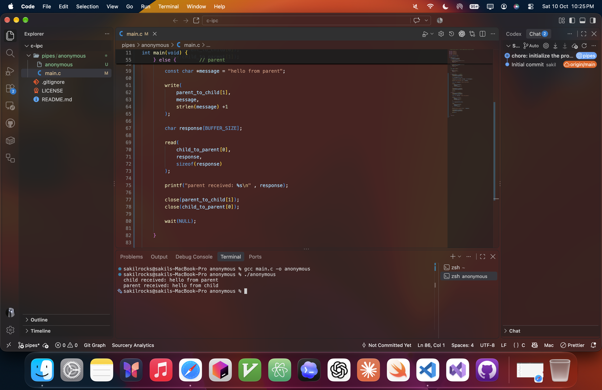
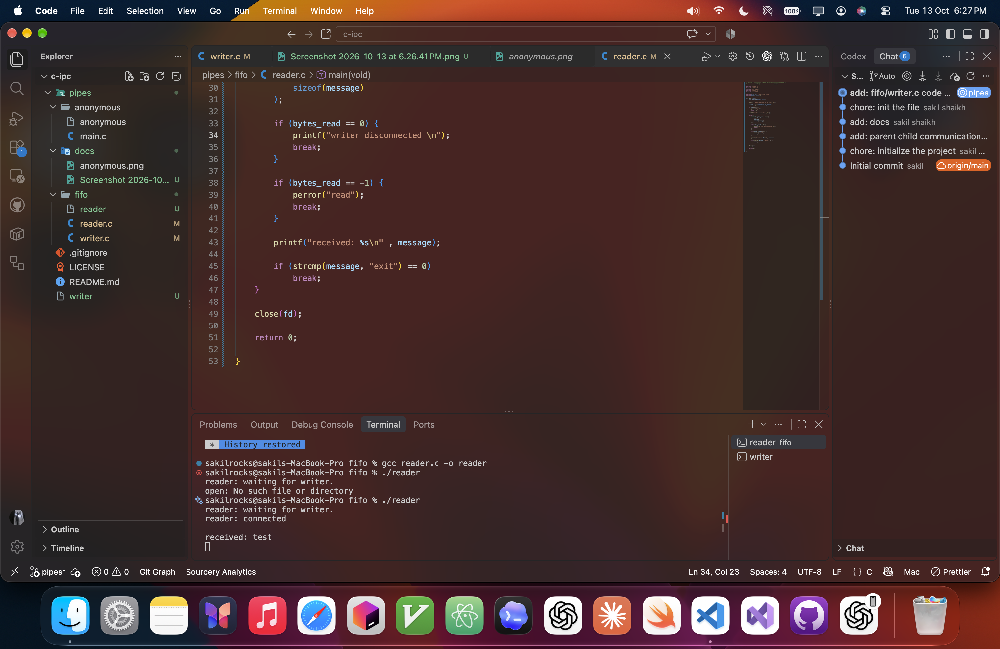
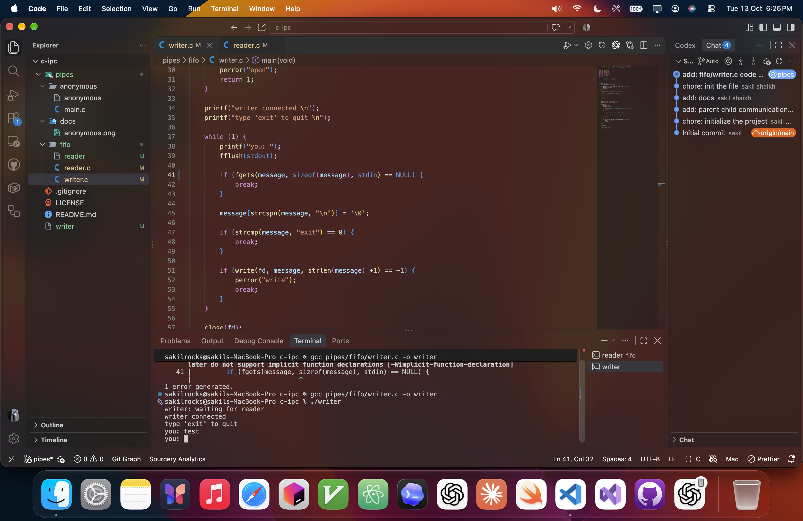
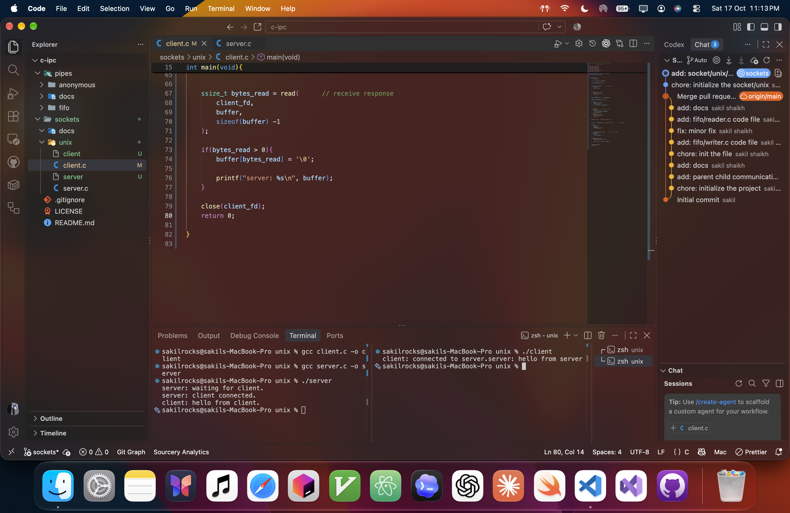
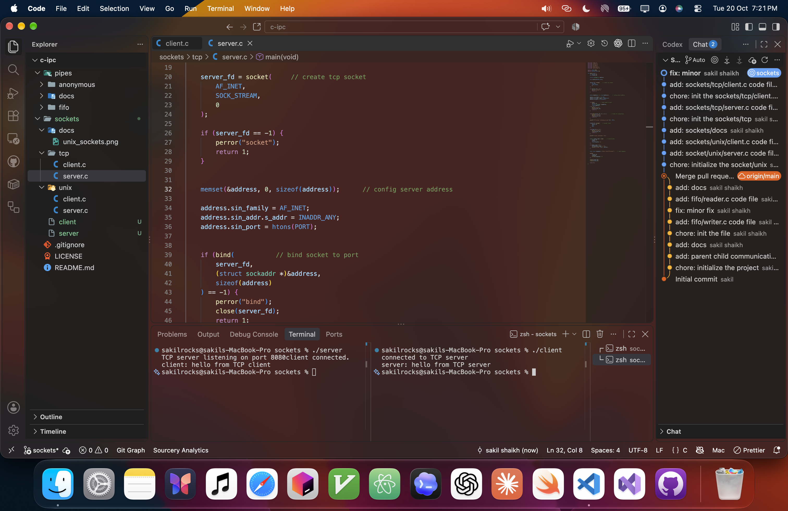

# c-ipc
a collection of C programs demonstrating Inter-Process Communication (IPC) using pipes and sockets on Unix like systems.

---

## Overview

This project explores four IPC mechanisms:

* Anonymous Pipes: Communication between parent and child processes.
* Named Pipes (FIFO): Communication between independent processes.
* Unix Domain Sockets: Bidirectional communication between local processes.
* TCP Sockets: Client-server communication over a network.

---

## Project Structure

```
c-ipc/
├── pipes/
│   ├── anonymous/
│   │   └── main.c
│   └── fifo/
│       ├── writer.c
│       └── reader.c
├── sockets/
│   ├── unix/
│   │   ├── server.c
│   │   └── client.c
│   └── tcp/
│       ├── server.c
│       └── client.c
└── README.md
```

---

## What Each File Does

```anonymous/main.c```: Demonstrates bidirectional parent-child communication using anonymous pipes.

```fifo/writer.c```: Sends messages through a named pipe.

```fifo/reader.c```: Reads messages from the named pipe.

```unix/server.c```: Creates a Unix domain socket and handles a client connection.

```unix/client.c```: Connects to the local server, sends a message, and receives a response.

```tcp/server.c```: Listens for TCP connections and responds to a client.

```tcp/client.c```: Connects to the TCP server and exchanges a message.

---

## How It Works

Each program uses OS APIs to exchange data between processes.

* Anonymous pipes use *pipe()* and *fork()* to connect related processes.
* Named pipes use *mkfifo()* to create a FIFO that independent processes can access.
* Unix domain sockets use *AF_UNIX* for local, bidirectional communication.
* TCP sockets use *AF_INET* and *SOCK_STREAM* for reliable communication over a network.

---

## Build and Run

compile each program using GCC from the project root.

1. Anonymous Pipes
```
gcc pipes/anonymous/main.c -o anonymous
./anonymous
```


2. Named Pipes (FIFO)
```
gcc pipes/fifo/reader.c -o reader
gcc pipes/fifo/writer.c -o writer
```

Run ```./reader``` and ```./writer``` in separate terminals.




3. Unix Domain Sockets
```
gcc sockets/unix/server.c -o unix_server
gcc sockets/unix/client.c -o unix_client
```

Run ```./unix_server``` first, then ```./unix_client``` in another terminal.



4. TCP Sockets
```
gcc sockets/tcp/server.c -o tcp_server
gcc sockets/tcp/client.c -o tcp_client
```

Run ```./tcp_server``` first, then ```./tcp_client``` in another terminal. The client defaults to **127.0.0.1**, so both programs run on the same
machine unless you change the server address.


